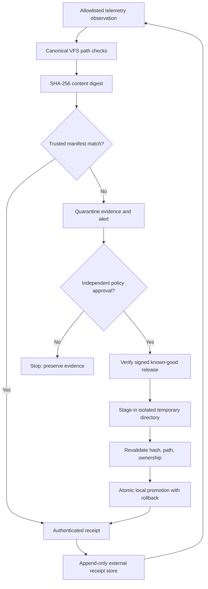

# TDOC — Architect_01 Ouroboros Cryptographic Defense v1

> **Status:** Design specification; not deployed, not cryptographically attested. **Scope:** UNIOMNI Stage-0 / ideal-enigma. **Mode:** observe-first, fail-closed, approval-gated recovery.

## 1. Purpose and boundaries

Telemetry-Driven Cryptographic Defense observes authorized UNIOMNI files and processes, detects drift, creates reproducible integrity evidence, and proposes recovery from known-good releases. **Ouroboros** means bounded *reconstruction from trusted sources*, **not** network propagation, autonomous copying to other devices, self-modifying code, or self-authorization.

## 2. Architect_01 identity and trust

| Field | Value / requirement |
| --- | --- |
| Principal label | `Architect_01` |
| Account reference | `machackabook@gmail.com` (identifier only; ownership not verified here) |
| Legacy reference | `137451921129154222` (public identifier, **not a secret**) |
| Hex reference | `0x77446C2E` (public identifier, **not a secret**) |
| Trust anchor | Separately generated signing key with independently protected public-key pin |
| Receipt primitive | SHA-256 digest **plus** authenticated signature or HMAC |
| Storage | Canonical VFS paths beneath an explicitly configured root; no symlink traversal |
| Default authority | Read-only; recovery requires explicit approval |

Neither supplied identifier has demonstrated high entropy or suitability as a cryptographic key. Never store a signing secret in a public repository, README, telemetry event, or receipt.

## 3. Architecture



## 4. Telemetry event schema

| Field | Type | Validation |
| --- | --- | --- |
| `event_id` | UUID/string | Unique per event; never recycled |
| `timestamp_utc` | RFC3339 string | Monotonic sequencing recorded separately |
| `actor` | string | Authorized principal or service identifier |
| `asset_path` | string | Relative normalized path; no `..`, absolute paths or symlinks |
| `event_type` | enum | `observe`, `drift`, `verify`, `approve`, `restore`, `fail` |
| `sha256_before`, `sha256_after` | 64-char hex/null | Hash of actual file bytes, not filenames |
| `manifest_digest` | 64-char hex | Pins approved source manifest |
| `previous_receipt_digest` | 64-char hex/null | Links sequential receipts; not sufficient against history rewrite |
| `decision` | enum | `allow`, `deny`, `review` |
| `signature` | encoded signature | Verified using separately trusted key |

Canonicalize the event as a versioned deterministic byte encoding before signing. Record key ID, algorithm, schema version and verification result. Redact secrets and personal telemetry.

## 5. Ouroboros state machine

```text
OBSERVE -> DIGEST -> VERIFY -> CLASSIFY
                              | PASS -> SEAL -> MONITOR
                              | FAIL -> ALERT -> REVIEW
                                               | DENY -> STOP
                                               | APPROVE -> STAGE -> VERIFY -> RESTORE -> SEAL
```

**Invariant A — scope:** no writing outside an explicit allowlist; no automatic cross-device fan-out.

**Invariant B — trust:** observed runtime cannot approve itself; trust anchors and approvals remain outside the mutable artifact.

**Invariant C — audit:** never suppress errors, overwrite evidence, rewrite receipts or claim a hash is tamper-proof.

**Invariant D — reversibility:** stage atomically, preserve original bytes, maintain rollback and stop on mismatches.

**Invariant E — least privilege:** no root, arbitrary code execution, unattended installation or network listening required for the observation phase.

## 6. UNIOMNI integration contract

| Existing path | Integration |
| --- | --- |
| `UNIOMNI_STAGE0.sh` | Keep installer unchanged until the new defense module passes review; embedded release payload must not be edited without rebuilding and verifying it |
| `tools/verify.py` | Existing release digest verification remains the local baseline; it does not authenticate authorship |
| `runtime/uniomni.py` | Proposed read-only `integrity status` command, pending implementation |
| `layers/manifest.json` | Preserve existing layer handling and provenance; never promote reference-only layers |
| `tools/tdoc_index.py` | Index this named TDOC separately from numeric TDOC slots |
| `tdoc-index/catalog.json` | Public metadata only; never store private account or machine telemetry |
| `docs/TDOC-LINEAGE-00000-10124.md` | Enforce source-evidence gate and avoid inventing numeric dependencies |

## 7. Implementation milestones and acceptance tests

| Gate | Work | Minimal acceptance evidence |
| --- | --- | --- |
| G0 | Documentation and trust model | This document linked from README; no runtime change |
| G1 | Read-only local VFS scanner | Fixture detects modified bytes, rejects symlink escapes, never writes to scanned tree |
| G2 | Deterministic receipts | Same canonical event hashes identically; tampering invalidates verification |
| G3 | Authenticated signatures | Wrong key, changed content and replayed sequence are rejected |
| G4 | Approval-gated recovery | No approval means no writes; bad manifest means no writes |
| G5 | Atomic rollback | Interrupted recovery preserves original and produces failure receipt |
| G6 | CI and public gate | Test suite passes, no secret disclosure, reviewer explicitly approves release |

## 8. Failure matrix

| Failure | Required response |
| --- | --- |
| Unreadable file or permission denied | Report unknown state; do not silently skip |
| Manifest digest mismatch | Fail closed; preserve evidence |
| Invalid signature / untrusted key | Reject artifact; alert |
| Broken receipt chain | Flag unverifiable history; do not repair by rewriting |
| Symlink, traversal or unexpected mount | Refuse path; log reason |
| Missing predecessor TDOC | Mark unresolved; do not infer operational dependency |
| Network unavailable | Continue local observation; queue *non-sensitive* receipts only if configured |
| Recovery interrupted | Stop, rollback if safe, preserve original and receipt |

## 9. Security and publication

Public GitHub receives architecture, redacted schemas, tests and code reviewed for secrets. Private credentials, signing keys, raw device telemetry, sensitive paths and identity proof belong in separately access-controlled stores. A public SHA-256 hash is a consistency checksum; tamper-evident receipts require independently protected verification material and preferably external append-only anchoring.

## 10. Evidence ledger

- **Verified in repository:** UNIOMNI Stage-0 installer, `tools/verify.py`, existing TDOC lineage gate and public index exist on the development branch.
- **Specified here, not yet implemented:** live telemetry sensor, signing keys, signature verification, autonomous recovery, external receipt store, continuous monitoring and production alerting.
- **Release decision:** **NOT READY** until G1–G6 evidence exists. No main-branch merge or Cloudflare publication implied.
