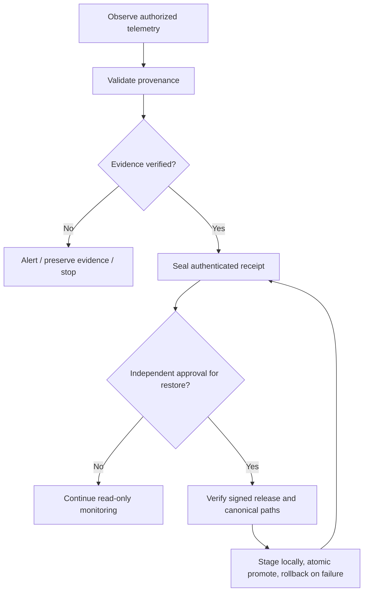

# TDOC — Sovereign Sentinel v2: AI Compliance, HPC Attestation & Merkle Audit

> **State:** architecture and integration contract, not deployed. **Parent:** [Architect_01 Ouroboros v1](TDOC-ARCHITECT01-OUROBOROS-CRYPTODEFENSE-v1.md). **Target:** UNIOMNI Stage-0, `ideal-enigma`. No automatic execution, credential exposure or autonomous cross-device replication.

## Executive summary

Build three bounded adapters behind a shared **observe → validate → classify → attest → review → recover** gate. A valid event is evidence of a measurement, not proof of regulatory compliance, hardware security or geographic residency. Each adapter must report `verified`, `unverified`, `unavailable` or `failed`, with source provenance.

| Adapter | Input | Output | Trust boundary |
| --- | --- | --- | --- |
| EU AI Act profiler | Approved model inventory, provider disclosures, evaluation datasets | Risk registry and conformity evidence manifest | Does not certify legal compliance |
| Slurm/HPC observer | Authorized `sinfo`, `squeue`, `sacct` and hardware counters | Partition/job telemetry and attestation references | Scheduler metrics are not hardware attestation |
| Merkle access auditor | Privacy-minimized access events and signed receipts | Merkle roots, inclusion proofs, signature verification | Hash inclusion does not prove geography or authorization |
| Ouroboros recovery gate | Signed manifest, verified local snapshot, independent approval | Staged rollback-capable restore receipt | Never self-approves or propagates |

## 1. EU AI Act compliance profiler

### Model registry schema

- `model_id`, `provider`, `model_version`, `deployment_region`, `deployment_purpose`, `owner`, `inventory_timestamp`.
- `model_type` and separately assessed `provider_role`/`deployer_role`; `risk_tier` is an assessed classification, not a model-name heuristic.
- `assessment_basis`: documented use case, jurisdiction, source citations, evaluator and review date.
- `evaluation`: benchmark version, population/sampling limitations, observed metrics, confidence intervals and raw-data location (private).
- `lineage`: source model, fine-tuning event, training provenance references, licensing and change receipt.
- `standard_mapping`: applicable published standard or regulatory requirement, applicability decision, evidence link, gap and reviewer.
- `systemic_risk`: separately assessed under applicable general-purpose AI model rules; do not infer from token variance alone.

### Required checks

1. Discover models through explicitly authorized provider inventory APIs or manually attested manifests; never invent versions or treat a named stream as available.
2. Record token distribution shifts, measured evaluation outcomes and downstream fine-tuning changes only when the provider exposes those measurements and the dataset is documented.
3. Treat any alignment/coherence score as a *defined measurement* with methodology and confidence, not as a universal safety percentage.
4. Map obligations to the applicable EU AI Act provisions and current harmonized standards; a generic checkbox is not a conformity assessment.
5. Seal a **redacted evidence manifest** in IndexedDB for local browser review. Use Web Crypto signatures only when an independently controlled signing key is available; SHA-256 alone is not a signature. IndexedDB is mutable local storage, not an immutable or hardware-backed ledger.
6. Keep training data, user content, credentials and raw sensitive evaluations in approved private stores; public artifacts contain only non-sensitive metadata and references.

**Acceptance:** missing provenance and unavailable metrics display `unverified`, not fabricated values; offline use works for already stored records; unauthorized provider requests never occur.

## 2. Confidential compute enclave & Slurm telemetry

### Scheduler adapter

Collect only on authorized HPC clusters:

| Source | Measured fields | Caveat |
| --- | --- | --- |
| `sinfo` | Partition, node count, availability/state, constraints | Snapshot, not reservation guarantee |
| `squeue` | Job ID, array index, state, allocation, elapsed time | Respect job visibility and tenant boundaries |
| `sacct` | Historical job state and resource accounting | Requires configured accounting and permission |
| Vendor GPU tools | GPU utilization, memory, supported tensor-related counters | Do not label generic GPU usage “tensor-core utilization” |
| Node inventory | Hardware architecture and confidential-compute capability | Capability does not prove active attestation |

### Attestation contract

Hardware-rooted attestation requires a supported trusted execution environment and a verified vendor/platform quote, certificate chain, nonce, measurement policy and freshness. A SHA-256 hash of RAM, browser state or a `sys-verify` string is **not** hardware attestation. Slurm allocation metadata does not prove that workload memory is sealed.

- Read-only discovery first; no scheduler submissions, cancellation, privileged access or partition changes.
- Reject untrusted quotes, stale nonces and policy mismatches.
- Return `unavailable` when the hardware, driver, quote service or verifier is absent.
- Avoid raw memory dumps and private job payloads.

## 3. Sovereign Merkle proofs & multi-tenant logs

### Event minimization

Canonical event: `schema_version`, `event_id`, `timestamp_utc`, `tenant_pseudonym`, `operation`, `decision`, `resource_commitment`, `region_policy_id`, `key_id`, `previous_receipt_hash`. Do not include raw emails, file paths, keys or payloads in public audit leaves.

- Compute a deterministic leaf hash with domain separation, e.g. `SHA256(0x00 || canonical_event)`.
- Compute internal nodes with separate prefix, e.g. `SHA256(0x01 || left || right)`.
- Preserve tree size, algorithm version, root and inclusion path; reject malformed proofs.
- Anchor signed roots in an independently controlled append-only location. Without external anchoring, an administrator can replace both the data and root.
- Multi-signature regional approval uses independently held keys and a documented quorum policy. A region label or signed log **cannot prove physical data residency**; corroborate with cloud placement controls, provider evidence and independent audits.
- Zero-knowledge claims require a specified statement, proof system, circuit, setup/trust assumptions, prover and verifier. Hashing or redacting paths is privacy minimization, **not a zero-knowledge proof**.
- Do not implement identity “unmasking” based on pseudonyms. Access decisions must use consented, authenticated, least-privilege identity claims.

## 4. Ouroboros restoration boundary

**Never:** replicate to discovered hosts, auto-unmask tenants, regenerate missing signing keys from public IDs, execute recovered scripts without review, suppress security failures, or call an unsigned Base64 snapshot a survival proof.

## 5. Repository integration map

| Path | Proposed role | Implementation status |
| --- | --- | --- |
| `UNIOMNI_STAGE0.sh` | Existing signed-by-digest embedded release bootstrap | Unchanged; rebuilding payload requires separate verified release |
| `docs/TDOC-ARCHITECT01-OUROBOROS-CRYPTODEFENSE-v1.md` | Parent trust and recovery policy | Documented |
| `docs/TDOC-SOVEREIGN-SENTINEL-COMPLIANCE-HPC-MERKLE-v2.md` | This design and acceptance contract | Documented |
| `src/services/sovereignSentinelCore.ts` | Proposed browser-side orchestration and state types | Not implemented |
| `runtime/security/` | Proposed read-only local collectors | Not implemented |
| `tools/verify.py` | Existing release digest baseline | Not hardware attestation |
| `tdoc-index/` | Public, non-sensitive discovery metadata | Existing index; no private events |

## 6. Test and release gates

| Gate | Test | Pass criterion |
| --- | --- | --- |
| C1 | Model inventory missing provenance | Explicit `unverified`; no false compliance claim |
| C2 | Provider metric unavailable | Null/unavailable, never synthetic scores |
| H1 | Slurm absent or unauthorized | Graceful `unavailable`, no privileged fallback |
| H2 | Quote replay / wrong trust chain | Attestation rejected |
| M1 | Mutated Merkle leaf/path/root | Inclusion verification fails |
| M2 | Unauthorized tenant or missing signature quorum | Access/approval denied |
| R1 | Modified recovery artifact | No restore; failure receipt |
| R2 | Approval missing | Zero filesystem mutations |
| P1 | Public artifact privacy scan | No credentials, private paths or user telemetry |

## 7. Open decisions

- Legal reviewer, applicable jurisdiction and intended deployment use cases.
- Actual model-provider inventory access and metric availability.
- HPC cluster operator approval, Slurm configuration and hardware TEE support.
- Receipt-signing key custody, trusted root anchoring and regional quorum policy.
- Whether browser IndexedDB should be an offline cache or local evidence store; neither choice makes it immutable.

**Release status: HOLD.** No claim of EU conformity, systemic-risk clearance, live Gemini stream integration, hardware enclave activation, zero-knowledge verification, or production-ready Ouroboros self-reconstitution.
